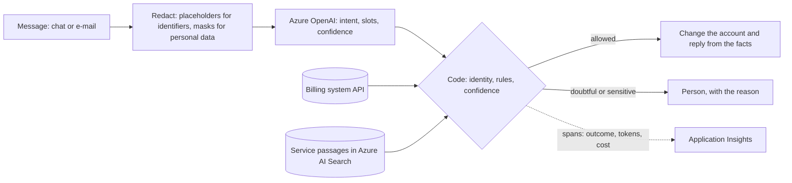

# utility-agent-genaiops

**A customer-service agent for an energy utility, run the GenAIOps way on Azure: evaluated before every release,
traced, costed per conversation, and handed over with a runbook.**

Customers of a German energy supplier write in about meter readings, monthly instalments (Abschlag), payment plans,
high bills, tariff switches, moves and cancellations, in German and English, with typos, IBANs and phone numbers in
the text. The agent answers what it may, changes what the rules allow, and hands everything else to a person.
Building it is the smaller part. This repository is about running it: what decides a release, what the traces
show, what a conversation costs, and what the team that takes it over needs.


## Results

Dev world: 2,000 production messages, 66 % German, a golden set of
600 messages labelled with the right outcome, and the 10 happy-path chats a team would show in a demo.
Every number below is written by `scripts/evaluate.py` into `reports/dev.json` and copied here by
`scripts/readme.py`; CI regenerates both and fails on any difference.

| | Model decides | Model reads, code decides |
|---|--:|--:|
| Harmful actions per 1,000 messages | 97 | **2** |
| Handled right | 89.15% | **96.5%** |
| Messages with personal data sent to the model | 1,500 | **3** |
| Model cost per conversation | €0.0097 | **€0.0045** |

| | Ship if the demo looks right | Ship through the gate |
|---|--:|--:|
| Regressions shipped (of 8 candidates) | 3 | **1** |
| Harmful actions customers met over the 8 releases | 205 | **44** |

### Model reads, code decides

A harmful action is a wrong change to an account (an implausible meter reading accepted, an instalment set below
the floor, a payment plan outside the rules, a wrong cancellation date), account data given to someone who is not
identified, or a customer facing a supply interruption not handed to a person the same day.

| Design | Handled right | Harmful actions per 1,000 | Without a person | Model cost per chat | Messages with personal data sent to the model |
|---|--:|--:|--:|--:|--:|
| Model decides (rules in the prompt) | 89.15% | 97 | 89.35% | €0.0097 | 1,500 of 1,517 |
| Model reads, code decides | 96.5% | 2 | 84.8% | €0.0045 | 3 of 1,517 |

When the model decides, it gets the raw message and the rules in its prompt: 97 harmful actions
per 1,000 messages and every IBAN and phone number in its context. In the guarded design the code takes personal
data out first (customer numbers and postcodes become placeholders the code maps back; IBAN, e-mail, phone, birth
date and signature names become masks), the model returns intent, slots and a confidence, and code checks identity
and applies the rules. Replies are written from the decision, so no model writes a number. Readings below 0.6
confidence go to a person.

### Releases: a gate, not a demo

Eight candidate changes arrive one after another: a prompt fix for German number formats, a cheaper model, a lower
handover threshold, few-shot examples, a new model, a date-format fix, the new model again, a shorter prompt. Each
is judged two ways, starting from the same production release with the same customers and the same model luck:
by the 10 demo chats, and by the gate, which runs the 600-message golden set against production and
ships only if a paired bootstrap shows no drop of more than half a point in messages handled right, no extra
harmful action, and a model cost under €0.006 per conversation.

| Candidate | Demo of 10 chats | Gate on the golden set |
|---|--:|--:|
| r1 German number format in the prompt | shipped | shipped |
| r2 mini model to cut cost | **shipped, a regression** | blocked (a real regression): may handle fewer messages right (lower bound -11.83 pts); +20 harmful actions on the golden set |
| r3 hand over less (threshold 0.4) | **shipped, a regression** | blocked (a real regression): +6 harmful actions on the golden set |
| r4 few-shot examples | shipped | shipped |
| r5 new model large-2026 | shipped | **shipped, a regression** |
| r6 date format in the prompt | shipped | shipped |
| r7 new model large-2026, again | shipped | shipped |
| r8 shorter prompt to cut cost | **shipped, a regression** | blocked (a real regression): may handle fewer messages right (lower bound -5.17 pts); +3 harmful actions on the golden set |

| Release process | Regressions shipped | Improvements blocked | Harmful actions customers met | Handled right at the end | Harmful per 1,000 at the end | Cost per chat at the end |
|---|--:|--:|--:|--:|--:|--:|
| Ship if the demo chats look right | 3 | 0 | 205 | 96.1% | 8 | €0.0035 |
| Ship through the gate | 1 | 0 | 44 | 96.5% | 2 | €0.0045 |

The gate missed one: the new model reads "03/04/2027" in English messages as the 4th of March. The golden set,
drawn from the traffic mix, held 2 such dates (production traffic 11), so the gate
could not see it; the date-format prompt fixed it one release later. The fix for the process is a golden set
stratified by risk, not by traffic share.

### Cost and the business case

At the release in production after the gate (large-2026, prompt v4, few-shot examples
on), a conversation costs €0.0045 in model tokens.
With the assumptions in `config/policy.toml` (60,000 contacts a month, €5.20 for a contact a
person handles), the agent handles 50,640 contacts a month right without a person: about
€263,060 a month for €268 of model cost, with
120 harmful actions a month to catch in review. The contact cost is an assumption to
replace with the customer's own figure in the first workshop.

## Held-out world

Not run yet: `python3 scripts/evaluate.py --heldout` (once).

## How it works



- `src/utilityagent/redact.py`, `policy.py`, `agent.py`: redaction, the utility's rules, the two designs.
- `src/utilityagent/evals.py`: golden-set scoring, harmful-action definition, the release gate.
- `src/utilityagent/telemetry.py`: OpenTelemetry; Application Insights when its connection string is set.
- `src/utilityagent/model.py`: the Azure OpenAI adapter (JSON output, deployments per model) and cost accounting.
- `src/utilityagent/service/`: FastAPI, `POST /v1/messages`; the offline keyword reader for local runs.
- `src/utilityagent/world/`: customers, messages, the truth, and a model whose mistakes depend on the release.
  Only the evaluation and the tests read it.
- `infra/terraform/`: Azure Container Apps, Azure OpenAI deployments, Azure AI Search, Key Vault with a managed
  identity, Log Analytics and Application Insights, alerts. Validated in CI, not applied.
- `docs/RUNBOOK.md`: the handover: what runs where, the alerts, how to roll back, how to ship a release.
- `web/`: the console (React, Framer Motion) reading `web/public/data/console.json`.

## Run it

```bash
pip install -e '.[dev]'
python -m pytest -q                        # about 1 s
python3 scripts/evaluate.py                # dev world and the release experiment, about 15 s
python3 scripts/readme.py && python3 scripts/handover.py
uvicorn utilityagent.service.main:app      # offline reader; set AZURE_OPENAI_ENDPOINT and _API_KEY for the model
cd web && npm ci && npm run dev
```

## Limits

- The customers, the billing system and the model are simulated. The model's error rates per release are set in
  `config/world.toml`; a real model fails in more ways, so the gate's thresholds have to be tuned on real labels.
- The Azure OpenAI adapter is tested against a mock, not a live deployment; the Terraform is validated, not applied.
- The offline keyword reader exists so the API runs without a model; it is not measured.
- The business case uses assumed contact volumes and costs.
